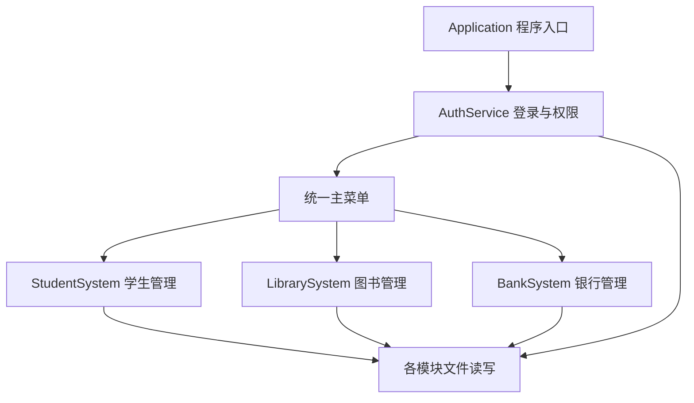
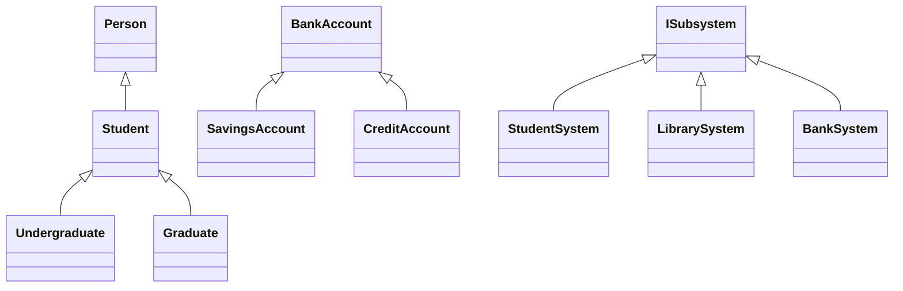
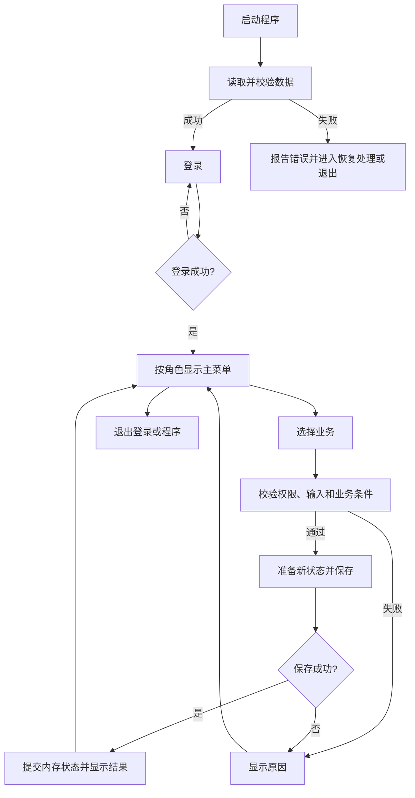

# 校园综合管理系统

基于 C++ 的课程设计项目，整合学生管理、图书管理和银行账户管理三个子系统，通过统一登录、主菜单和学号关联提供校园业务管理功能。

> **文档状态：设计草案。** 本文用于说明拟实现的功能和设计约定，不代表代码、构建配置或测试已经完成。所有开发清单均待实际实现后更新。
>
> **课程使用说明：** 原课程文件明确写明“不允许用AI生成，直接用AI生成的判为不合格”。本文件由 AI 辅助整理，作为设计讨论与学习参考；小组应依据课程规定自行完成设计落实、编码、调试和报告，并真实记录个人工作。

## 1. 项目目标

- 以统一程序整合三个子系统，支持登录、业务操作、数据保存和退出。
- 使用类与对象、封装、继承、多态和多文件编程完成开发。
- 每位成员独立负责一个子系统，同时参与接口约定与集成。
- 对非法输入、权限不足、数据冲突和文件错误给出明确提示。
- 保留真实开发周记、测试记录和设计说明，支持课程答辩。

银行模块为本地教学模拟，不连接真实银行或支付服务。

## 2. 课程要求与设计对应

依据文件：`C++课程设计详细要求-2026-AI拔尖班.doc`。

| 课程要求 | 本项目设计 |
| --- | --- |
| 2—3 人一组，每人完成一个子系统，最后统一整合 | 本方案按三人分别负责学生、图书、银行设计 |
| 使用类与对象、封装、继承、多态 | 业务实体封装、学生和账户继承体系、虚函数调用 |
| 类层次在两层以上 | 使用 `Person → Student → Undergraduate / Graduate` 三层结构 |
| 多文件编程 | 按公共模块与业务模块拆分头文件和源文件 |
| 文件处理数据 | 保存用户、学生、图书、借阅、账户与交易数据 |
| 用户账号管理，处理用户名和密码 | 统一登录、密码验证、修改密码及账号状态管理 |
| 程序、类、函数需要详细注释 | 说明属性、方法、继承关系、参数、步骤及关键算法 |
| 每周记录进展和问题 | 各成员每周记录已完成工作、问题与解决过程 |
| 提交源码、周记及报告 | 按课程要求准备电子材料和纸质材料 |

下文采用的 C++17、控制台界面、文件名称、角色划分及具体类名均为设计建议，不是课程文件指定的技术要求。

## 3. 技术方案

| 项目 | 约定 |
| --- | --- |
| 编程语言 | C++17 |
| 交互方式 | 控制台菜单 |
| 数据保存 | 带版本标记的本地文本文件 |
| 文件编码 | UTF-8，统一编译器及终端的中文显示设置 |
| 编号类型 | 学号、用户编号、图书编号、账号均使用 `std::string` |
| 金额类型 | `std::int64_t`，单位为分 |
| 日期格式 | `YYYY-MM-DD`，解析时校验真实日期 |
| 日期时间格式 | `YYYY-MM-DD HH:MM:SS`，采用统一的本地时间约定 |
| 对象管理 | 普通值对象配合 STL 容器；多态对象使用 `std::unique_ptr` |
| 运行范围 | 单机、单进程操作同一份数据文件 |

初期不加入网络通信和图形界面，先完成基础业务及持久化。开发工具、构建工具和密码哈希依赖由小组在首次集成前统一确定。

## 4. 系统架构



系统职责分为三部分：

1. **交互层：** 显示菜单、读取输入、展示结果。
2. **业务层：** 检查权限和业务条件，执行注册、借还书、转账等操作。
3. **存储层：** 解析和校验数据文件、保存业务状态、报告读写错误。

初期可将业务操作和文件读写分别实现为各子系统的成员函数，但应保持函数职责清晰，避免把所有逻辑堆在菜单函数中。

### 4.1 数据关联

- `userId` 标识登录用户，`studentId` 标识学生档案，两者不能混用。
- 学生用户关联一个学号；管理员可以没有关联学号。
- 借阅记录通过学号关联借阅人，通过图书编号关联书目。
- 银行账户通过学号关联账户所有者，账号独立且唯一。
- 登录账号停用、学籍注销和银行账户停用是不同业务状态，需要分别处理。
- 学生、图书和账户之间使用编号关联，不建立不合理的继承关系。

### 4.2 跨模块查询

由主程序提供统一的学生查询入口，供图书与银行模块检查学生是否存在、是否在籍。其他模块通过该入口获取只读信息，不能各自维护一份可修改的学生档案。

第一版采用分步办理的注销流程：先归还图书，再结清并停用银行账户，最后注销学籍、禁用关联学生登录账号。已完成的各步操作独立保存，可以检查状态后继续办理。

## 5. 用户与权限

第一版设置 `Admin` 和 `Student` 两种角色。

| 功能 | 管理员 | 学生 |
| --- | --- | --- |
| 学籍注册、录入、修改、删除、注销 | 可以 | 不可以 |
| 学生信息查询 | 全部档案 | 本人档案 |
| 学生统计 | 可以 | 不可以 |
| 图书查询 | 可以 | 可以 |
| 书目、分类、库存管理 | 可以 | 不可以 |
| 借阅和归还 | 查询全部记录、代办并记录操作人 | 办理本人业务 |
| 银行开户、账户状态管理 | 可以 | 不可以 |
| 存款、取款、转账 | 第一版不代办 | 操作本人账户，可向有效账户转账 |
| 银行余额和流水查询 | 管理查询 | 本人账户 |
| 用户创建、停用、密码重置 | 可以 | 不可以 |
| 修改本人密码 | 可以 | 可以 |

权限判断必须位于业务函数中。即使用户绕过菜单或输入他人编号，也不能越权执行操作。操作人的身份应来自登录会话，不能由用户输入决定。

首次使用通过初始化流程创建管理员，不在源码中写入固定密码。密码保存采用成熟的密码哈希方案及随机盐，不保存明文，也不使用 `std::hash` 代替密码哈希；具体依赖在实现前选定并记录。

## 6. 功能设计

### 6.1 学生管理

**基础功能：**

- 学籍注册与学生档案录入。
- 按学号、姓名、专业、班级查询。
- 修改姓名、联系方式、专业、班级和成绩等信息。
- 删除无关联业务的误录档案。
- 按专业、班级、学籍状态统计人数。
- 办理退学注销并保留历史信息。
- 保存数据，重启后恢复。

**分类与扩展：**

- 本科生：增加年级信息。
- 研究生：增加导师和研究方向信息。
- 按姓名、专业、成绩排序展示。
- 成绩如纳入第一版，先明确为单项百分制示例成绩，范围为 0—100；不据此宣称实现完整教务成绩系统。

**业务规则：**

- 学号唯一且创建后不随意修改；姓名允许重复。
- 学籍注册与登录用户创建是不同功能。
- 有借阅或交易历史的学生不直接物理删除。
- 注销前检查未归还图书以及未结清、未停用的银行账户。
- 注销学生不能新增借阅或开户；历史记录仍可由管理员查询。

### 6.2 图书管理

**基础功能：**

- 新增、修改、查询书目，维护图书分类。
- 按图书编号、书名、作者、分类查询。
- 图书入库及库存调整。
- 借阅和归还，查询借阅状态。
- 保存图书及借阅记录。

**库存模型：** 第一版按书目管理多册图书，每条借阅记录代表借出一册。

```text
可借数量 = 总册数 - 该书目未归还的借阅记录数
```

**业务规则：**

- 图书编号唯一，总册数为非负整数。
- 借阅前检查学生在籍、图书存在、可借数量大于零。
- 减少总册数后不能低于当前未归还数量。
- 归还必须对应有效且未归还的借阅记录，禁止重复归还。
- 有历史借阅记录的书目采用下架状态保留，避免历史关联丢失。
- 借阅期限和上限使用统一配置，小组在实现时确定具体数值。

**扩展功能：** 借阅历史、逾期提醒、借阅数量限制。日期比较基于解析后的日期值，覆盖跨月、跨年与闰年情况。

### 6.3 银行账户管理

**基础功能：**

- 为有效学生开户。
- 支持储蓄账户和信用账户。
- 存款、取款、转账、查询余额。
- 保存账户及交易记录。

| 账户类型 | 规则 |
| --- | --- |
| `SavingsAccount` 储蓄账户 | 余额不得小于零 |
| `CreditAccount` 信用账户 | 余额不得低于负信用额度；存款优先抵消负余额 |

**业务规则：**

- 账号唯一，账户所有者必须存在。
- 金额以分保存，例如 `12.50` 元保存为 `1250`。
- 从输入文本直接解析整数分，不先转为浮点数再乘以 100。
- 存取款和转账金额必须大于零，小数最多两位，并检查数值溢出。
- 转账前检查账户存在、账户可用、来源账户归属以及可用金额。
- 第一版拒绝向同一账号转账，转入账户可以属于其他学生。
- 关闭账户前要求余额为零，信用账户无欠款；保留历史流水。
- 失败操作不能改变余额或留下成功流水。

**转账保存流程：**

```text
校验输入、身份和双方账户
    → 在临时业务状态中完成扣款、入账与流水生成
    → 将账户和流水一起写入银行临时快照
    → 检查写入成功，使用平台支持的替换方式提交快照
    → 提交成功后更新正式内存状态并报告成功
```

账户与流水保存在同一银行快照中，避免分开保存导致不一致。不能采用“先删除正式文件，再重命名临时文件”的方式提交。替换操作必须验证目标平台上的行为，写入或提交失败时保留原状态并报告失败。该设计仍需通过文件错误与中断恢复测试验证，不等同于生产数据库事务。

**扩展功能：** 用户侧流水查询、储蓄利息计算。计息前需明确利率单位、计息周期、舍入规则及重复结算的处理方式。

## 7. 类设计与面向对象应用



| 类 | 主要数据 | 职责及拟定操作 |
| --- | --- | --- |
| `User` | 用户编号、用户名、密码验证数据、角色、学号、状态 | 封装登录身份 |
| `AuthService` | 用户集合、当前会话 | `login`、`logout`、`changePassword`、权限判断 |
| `Person` | 姓名、联系方式 | 人员公共信息 |
| `Student` | 学号、专业、班级、成绩、学籍状态 | 学生公共行为、虚函数 `displayInfo` |
| `Undergraduate` | 年级 | 本科生信息与展示 |
| `Graduate` | 导师、研究方向 | 研究生信息与展示 |
| `StudentSystem` | 学生集合 | `registerStudent`、`findStudent`、`updateStudent`、`removeStudent`、`withdrawStudent`、统计 |
| `Book` | 图书编号、书名、作者、分类、总册数、状态 | 封装书目信息 |
| `LoanRecord` | 借阅编号、学号、图书编号、借出日、到期日、归还日、操作人 | 保存单次借阅状态 |
| `LibrarySystem` | 图书集合、借阅记录集合 | `addBook`、`searchBooks`、`borrowBook`、`returnBook`、库存管理 |
| `BankAccount` | 账号、学号、余额、账户状态 | 封装余额及公共账户行为，提供虚函数 `canWithdraw` |
| `SavingsAccount` | 利率 | 储蓄账户取款规则 |
| `CreditAccount` | 信用额度 | 信用账户取款规则 |
| `Transaction` | 流水号、类型、金额、相关账号、时间、操作人 | 保存业务流水；单条转账流水关联双方账号 |
| `BankSystem` | 账户集合、交易集合 | `openAccount`、`deposit`、`withdraw`、`transfer`、查询 |
| `ISubsystem` | 无具体业务数据 | 约定 `showMenu`、`loadData`、`saveData`，提供虚析构函数 |
| `Application` | 登录服务、三个子系统 | 初始化、加载、菜单调度、退出及跨模块协调 |

上述方法名用于讨论接口，参数与返回类型需要在开发前统一。

### 7.1 封装

实体数据优先设为 `private`，通过校验后的成员函数更新。余额不能通过公开的任意赋值接口修改；菜单层不能直接修改业务容器。

### 7.2 继承与多态

- 使用 `std::vector<std::unique_ptr<Student>>` 保存不同类型学生，通过虚函数展示各自字段。
- 通过 `BankAccount` 基类接口调用不同账户的取款规则。
- 主程序通过 `ISubsystem` 接口调用各模块菜单与加载操作。
- 多态基类提供虚析构函数，派生类重写函数使用 `override`。
- 持久化保存类型标记，加载时创建对应派生类，避免丢失派生字段。

### 7.3 容器与接口约定

第一版可使用 `vector` 保存对象并通过线性查找定位编号；排序使用标准库算法。数据量较小时，清晰和正确优先于复杂索引。

业务操作统一返回成功状态与失败原因。输入工具负责格式解析，业务函数负责再次检查范围、权限和关联条件。向其他模块提供只读查询接口，避免暴露可修改容器或长期保存可能失效的对象指针。

## 8. 文件存储

| 文件 | 内容 |
| --- | --- |
| `data/users.txt` | 用户、角色、学号关联、账号状态和密码验证数据 |
| `data/students.txt` | 类型标记和学生档案 |
| `data/library.txt` | 图书、借阅记录及编号计数器 |
| `data/bank.txt` | 账户、交易流水及编号计数器 |

存储约定：

1. 每个文件首部保存格式版本，业务行保存记录类型和必要字段。
2. 学生类型使用如 `UNDERGRADUATE`、`GRADUATE` 的标记，账户类型使用如 `SAVINGS`、`CREDIT` 的标记。
3. 包含空格、引号和反斜杠的文本字段使用一致的转义规则，可使用 `std::quoted`；拒绝字段中的换行符。
4. 不直接把包含 `std::string`、指针或虚函数的对象内存写入文件。
5. 编号使用持久化的递增计数器等唯一生成策略，不使用“当前记录数加一”。
6. 数据加载先进入临时状态，全部校验通过后才替换正式数据。
7. 首次初始化允许创建空数据；已有运行目录中缺少数据文件时应提示异常，不能直接覆盖为空。
8. 解析错误、重复编号、非法金额及失效关联必须报告，不能静默丢弃后覆盖原文件。
9. 业务修改成功保存后再提示用户成功，不能仅依赖正常退出时保存。

## 9. 目录结构

以下是计划中的工程布局，当前 README 不代表这些文件已经创建。

```text
CampusSystem/
├── readme.md
├── main.cpp
├── app/
│   ├── Application.h / Application.cpp
│   └── ISubsystem.h
├── common/
│   ├── User.h / User.cpp
│   ├── AuthService.h / AuthService.cpp
│   ├── InputUtils.h / InputUtils.cpp
│   └── DateUtils.h / DateUtils.cpp
├── student/
│   ├── Person.h / Person.cpp
│   ├── Student.h / Student.cpp
│   ├── Undergraduate.h / Undergraduate.cpp
│   ├── Graduate.h / Graduate.cpp
│   └── StudentSystem.h / StudentSystem.cpp
├── library/
│   ├── Book.h / Book.cpp
│   ├── LoanRecord.h / LoanRecord.cpp
│   └── LibrarySystem.h / LibrarySystem.cpp
├── bank/
│   ├── BankAccount.h / BankAccount.cpp
│   ├── SavingsAccount.h / SavingsAccount.cpp
│   ├── CreditAccount.h / CreditAccount.cpp
│   ├── Transaction.h / Transaction.cpp
│   └── BankSystem.h / BankSystem.cpp
├── data/
├── tests/
└── docs/
    ├── design.md
    ├── test-records.md
    └── weekly-notes/
```

## 10. 主菜单与运行流程

```text
校园综合管理系统
1. 学生管理
2. 图书管理
3. 银行账户管理
4. 修改密码
5. 退出登录
0. 退出程序
```

根据角色显示可用子菜单，并在业务执行时重新检查权限。



**构建与启动说明待实现后补充。** 需要记录实际使用的编译器及版本、构建工具、依赖安装方法、构建命令、可执行文件位置、数据目录定位方式和首次初始化步骤。本阶段不提供尚未验证的运行命令。

## 11. 分工与开发计划

### 11.1 三人分工

| 成员 | 负责模块 | 交付内容 |
| --- | --- | --- |
| 成员 A（待填写） | 学生管理 | 学生继承体系、学籍业务、存储、测试、报告章节 |
| 成员 B（待填写） | 图书管理 | 书目及借阅业务、库存、存储、测试、报告章节 |
| 成员 C（待填写） | 银行管理 | 账户继承体系、存取款转账、存储、测试、报告章节 |
| 全体成员 | 公共部分 | 登录、权限、主菜单、输入规则、接口约定、集成和答辩 |

集成负责人由小组指定。所有成员均需理解公共接口和整体流程，个人贡献记录以实际工作为准。

### 11.2 开发顺序

- [ ] 确定模块边界、类关系、编号规则和文件格式。
- [ ] 确定编译环境、构建方式和密码哈希依赖。
- [ ] 完成主程序、登录和三个空子菜单，首次集成编译。
- [ ] 分别实现三个模块基础业务。
- [ ] 完成文件读写和重启恢复。
- [ ] 接入统一权限与跨模块查询。
- [ ] 完成错误处理和边界测试。
- [ ] 在基础功能通过后添加扩展功能。
- [ ] 整理真实测试记录、周记、报告及演示材料。

### 11.3 课程时间安排

| 周次 | 原课程安排 | 小组建议产出 |
| --- | --- | --- |
| 第 2—3 周 | 选题与准备 | 分工、需求清单、类图、接口草案 |
| 第 4—12 周 | 设计、编程、测试、撰写文档 | 可运行版本、周记、测试记录、报告 |
| 第 13—14 周 | 大作业答辩 | 演示数据、答辩演练、最终验证 |
| 第 15 周 | 提交材料 | 按课程要求整理和提交全部材料 |

## 12. 测试与验收

以下为待执行测试计划，不能作为已通过测试的证明。

| 编号 | 场景 | 预期结果 |
| --- | --- | --- |
| T01 | 正确账号密码、错误密码、停用账号 | 仅有效账号且密码正确时登录成功 |
| T02 | 学生访问他人档案或银行账户 | 业务函数拒绝越权 |
| T03 | 重复学号注册 | 拒绝注册，原档案不变 |
| T04 | 不同学生类型保存并重启 | 类型及派生字段完整恢复 |
| T05 | 注销仍有未还图书或未结清账户的学生 | 拒绝注销并说明原因 |
| T06 | 可借数量为零时借书 | 拒绝借阅，不新增记录 |
| T07 | 正常借书、还书及重复归还 | 库存计算正确，重复归还被拒绝 |
| T08 | 将总册数减少到未归还数量以下 | 拒绝库存调整 |
| T09 | 跨月、跨年及闰年日期 | 日期校验和逾期判断正确 |
| T10 | 负金额、零金额、三位小数、超大金额 | 拒绝非法金额，不改变余额 |
| T11 | 储蓄账户余额不足，信用账户超额度 | 拒绝取款或转账 |
| T12 | 正常跨账户转账 | 双方余额正确、总额不变，生成对应流水 |
| T13 | 转入账号不存在、已停用或与源账号相同 | 拒绝转账，余额不变 |
| T14 | 数据写入或提交失败 | 不报告成功，保留原数据与余额 |
| T15 | 操作成功后退出并重启 | 学生、借阅、余额和流水恢复一致 |
| T16 | 数据文件字段缺失、编号重复或格式损坏 | 明确报告错误，不静默覆盖原文件 |
| T17 | 菜单输入字母、空行、越界值或遇到输入结束 | 合理提示或退出，不死循环、不崩溃 |
| T18 | 转账写入期间中断程序后重启 | 恢复完整旧状态或完整新状态，不出现单边扣款 |

测试记录应包含：前置条件、输入、操作步骤、预期结果、实际结果、是否通过、修复情况及执行日期。

## 13. 报告、周记与答辩

课程总成绩中，平时成绩占 20%，期末答辩占 80%。文件列出的期末评价维度为正确性、设计合理性、报告完成情况、程序功能情况及测试答辩情况，各占 20%。

按附件报告模板组织内容：

1. **选题背景：** 问题、使用者、功能范围。
2. **系统设计：** 类体系、数据成员与成员函数说明、程序流程图。
3. **系统实现：** 各模块实现方法、数据结构、关键算法和文件处理。
4. **系统测试：** 测试用例、真实测试结果、分析与结论。
5. **总结：** 个人贡献、真实问题与解决方法、不足和改进方向。
6. **参考文献。**

每周记录实际完成内容、遇到的问题、处理过程、尚未解决的问题和下一周计划，不预写或虚构开发经历。

建议答辩演示顺序：管理员登录 → 学籍注册并创建学生用户 → 图书入库 → 银行开户 → 学生登录 → 借书和还书 → 存款和转账 → 展示一个失败案例 → 重启验证数据保留。

提交前检查：

- [ ] 源码和构建说明齐全，在指定环境中可运行。
- [ ] 基础功能、权限、边界条件和持久化经过实际验证。
- [ ] 类、函数和关键算法注释完整。
- [ ] 纸质报告和周记准备齐全，供答辩时提交。
- [ ] 源程序、电子周记和电子报告按班级要求整理。
- [ ] 每位成员能够解释自己负责模块及其与系统的连接方式。
- [ ] README 已按最终实现更新，不将计划功能写成已完成功能。
